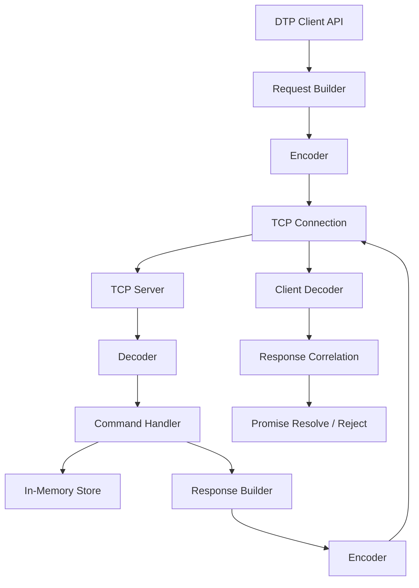
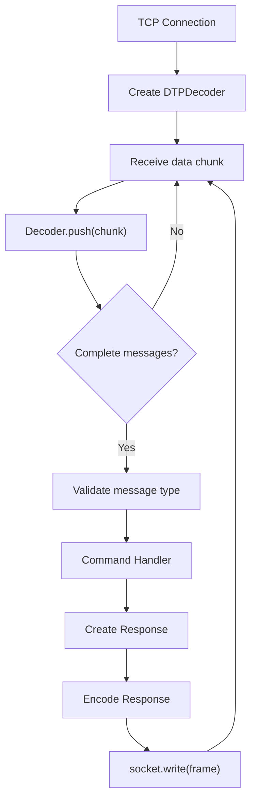
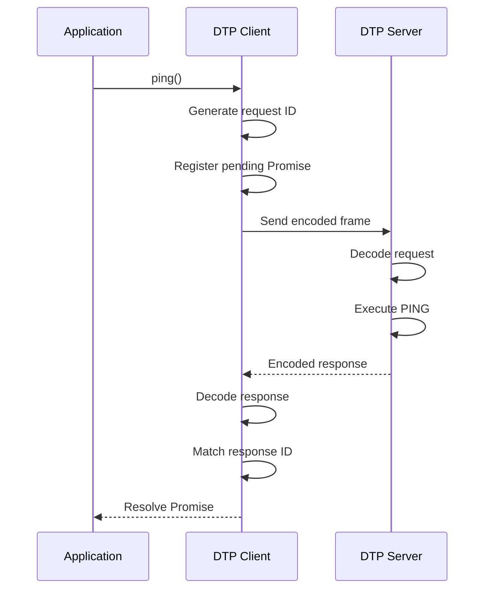

# DTP Architecture

This document describes the internal architecture and implementation of Daniel Transfer Protocol (DTP).

- [Project Overview](../README.md)
- [Protocol Specification](PROTOCOL.md)

---

## 1. High-Level Architecture

DTP follows a client-server architecture over TCP.



The protocol layer handles message encoding, decoding, and validation.

The client and server layers handle TCP communication and application behavior.

## 2. Project Structure

```text
src/
├── protocol/
│   ├── constants.ts
│   ├── types.ts
│   ├── encoder.ts
│   └── decoder.ts
│
├── server/
│   ├── handler.ts
│   └── server.ts
│   └── config.ts
│
├── client/
│   ├── client.ts
│   └── errors.ts
│   └── types.ts
│
└── index.ts
```

### Protocol Layer

The protocol layer defines the shared communication format.

#### constants.ts

Contains protocol constants:

- Magic signature
- Protocol version
- Header size
- Maximum payload size

#### types.ts

Defines request, response, and message types.

It also provides a response factory.

#### encoder.ts

Converts a DTP message into a binary frame.

The encoder:

1. Serializes the message as JSON.
2. Encodes the JSON as UTF-8.
3. Checks the payload size.
4. Allocates the frame.
5. Writes the magic signature.
6. Writes the payload length.
7. Copies the payload into the frame.

#### decoder.ts

Converts incoming TCP bytes into DTP messages.

The decoder is stateful because TCP does not preserve application message boundaries.

It maintains an internal buffer containing bytes that have not yet formed a complete message.

The decoder:

1. Accumulates incoming chunks.
2. Reads and validates the header.
3. Checks the payload length.
4. Waits for incomplete frames.
5. Extracts complete payloads.
6. Parses JSON.
7. Validates the message structure.
8. Preserves remaining bytes for the next chunk.

## 3. Why TCP Requires a Decoder

TCP provides an ordered byte stream, not individual application messages.

For example, the sender might write:

```text
[Message A][Message B]
```

The receiver might receive:

```text
Chunk 1: [Message A][Part of B]
Chunk 2: [Remaining B]
```

Or:

```text
Chunk 1: [Part of A]
Chunk 2: [Remaining A][Message B]
```

The sender's write boundaries are not guaranteed to match the receiver's data events.

DTP solves this with length-prefixed framing.

The decoder reads the header to determine exactly how many bytes belong to each message.

## 4. Server Architecture

The server uses Node.js's built-in `net` module.

It listens for TCP connections and creates an independent decoder for each connected socket.



### server.ts

Responsible for:

- Creating the TCP server
- Listening on the configured host and port
- Managing socket events
- Receiving incoming bytes
- Sending encoded responses
- Handling protocol and socket errors

Each TCP connection has its own decoder.

This matters because different TCP connections have independent byte streams and must not share decoder buffers.

### handler.ts

Contains application-level command logic.

Currently supported commands:

- PING
- ECHO
- TIME
- SET
- GET

The handler does not know about TCP sockets or binary framing.

It receives a request and returns a response.

This separation makes the command logic independently testable.

## 5. Client Architecture

The DTP client provides a Promise-based API over a persistent TCP connection.

Example:

```typescript
const client = new DTPClient({
  host: "127.0.0.1",
  port: 4040,
});

await client.connect();

const response = await client.ping();

await client.disconnect();
```

The client manages:

- TCP connection lifecycle
- Request ID generation
- Message encoding
- Incoming response decoding
- Pending request tracking
- Request timeouts
- Remote error handling

### Request lifecycle



## 6. Request/Response Correlation

The client uses a Map to track requests waiting for responses.

```typescript
private pending = new Map<number, PendingRequest>();
```

Each entry contains:

- Promise resolve function
- Promise reject function
- Timeout handle

Conceptually:

```text
pending
│
├── 1 → PING
├── 2 → TIME
└── 3 → ECHO
```

When a response arrives, the client uses its ID to find the corresponding pending request.

The matching entry is removed, its timeout is cleared, and its Promise is resolved or rejected.

This allows multiple outstanding requests to share one TCP connection.

The current server processes commands synchronously. The client uses IDs for correlation and does not depend on response arrival order.

## 7. Error Handling

DTP distinguishes between command errors and protocol-level failures.

### Command errors

The server can return a structured error response:

```json
{
  "version": 1,
  "id": 1,
  "type": "RESPONSE",
  "status": "ERROR",
  "payload": {
    "code": "UNKNOWN_COMMAND",
    "message": "Unknown command"
  }
}
```

The client converts this into a `DTPError`.

Applications can handle it with:

```typescript
try {
  await client.request("UNKNOWN_COMMAND");
} catch (error) {
  if (error instanceof DTPError) {
    console.log(error.code);
    console.log(error.message);
  }
}
```

### Protocol errors

Malformed frames, invalid JSON, unsupported versions, and invalid message structures are treated as protocol-level failures.

The current implementation closes the affected connection when it encounters malformed incoming data.

### Request timeouts

Each pending request has a timeout.

If a response does not arrive within the configured period, the corresponding Promise is rejected and its pending entry is removed.

## 8. CLI Architecture

The CLI is implemented separately from the reusable client.

```text
scripts/
└── dtp-cli.ts
```

It supports:

- Interactive command execution
- One-shot command execution
- Host and port configuration
- Human-readable responses
- Remote error reporting

The CLI uses the same `DTPClient` API available to other TypeScript applications.

It does not implement another TCP communication layer.

## 9. Testing Strategy

DTP uses Node.js's built-in test runner.

Tests are organized by responsibility:

| Test area          | Responsibility                          |
| ------------------ | --------------------------------------- |
| Protocol encoder   | Binary frame generation                 |
| Protocol decoder   | Frame parsing and validation            |
| Server handler     | Command behavior                        |
| Client integration | TCP communication and response handling |

The client integration test starts a temporary TCP server on an operating-system-assigned port.

This lets the client be tested without requiring a separately running production server.

## 10. Design Decisions

### Why TCP?

TCP provides a reliable, ordered byte stream.

DTP focuses on application-layer protocol design, so TCP provides a useful transport foundation without requiring us to implement transport-level reliability.

### Why binary framing with JSON payloads?

The binary header provides explicit message boundaries and a predictable payload length.

JSON keeps message structures readable and easy to inspect during development.

### Why not HTTP?

DTP is a learning project focused on understanding custom application-layer protocol design.

HTTP already defines its own message framing, request/response semantics, and conventions. Building DTP directly over TCP makes those concepts easier to explore.

### Why message IDs?

Message IDs allow the client to match responses with pending requests.

They provide a foundation for concurrent requests and future asynchronous server processing.

### Why separate protocol and command handling?

The protocol layer should not depend on application commands.

The same encoder, decoder, and message format could be reused by other applications with different command handlers.

## 11. Current Limitations

DTP is an educational prototype.

Current limitations include:

- No authentication or TLS
- No persistent storage
- No advanced backpressure handling
- No connection-level buffer limits or idle timeouts
- No protocol negotiation
- No asynchronous command execution
- Limited validation and error codes
- No production-grade reconnection strategy

These are possible future development areas, not features currently implemented.

---

## Related Documentation

- [README](../README.md)
- [Protocol Specification](PROTOCOL.md)
